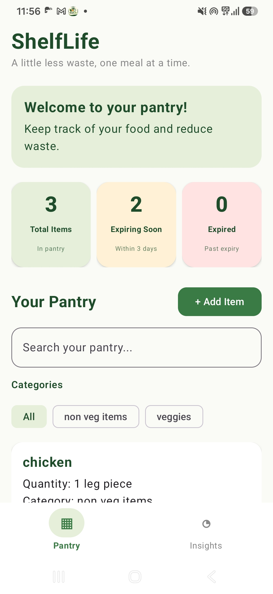
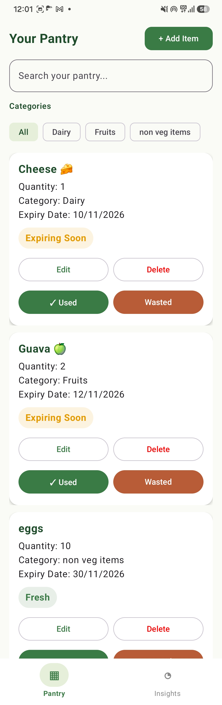
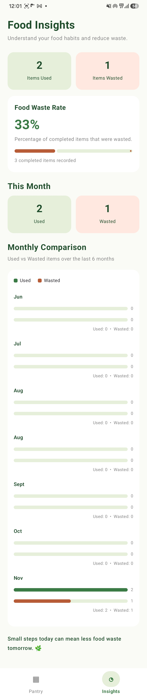
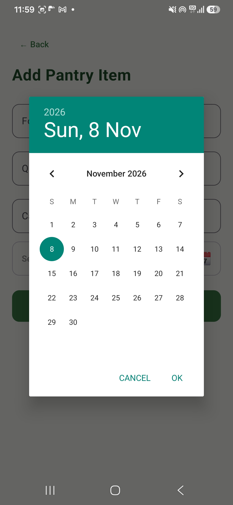

# 🌿 ShelfLife

### A little less waste, one meal at a time.

ShelfLife is an Android pantry management application designed to help users track food items, monitor expiry dates, and reduce household food waste.

## ✨ Features

- **Pantry Management:** Add, edit, and delete food items.
- **Expiry Date Tracking:** Select expiry dates using a calendar date picker.
- **Expiry Status:** Identify fresh, expiring soon, and expired items.
- **Dashboard:** View total pantry items, items expiring soon, and expired items.
- **Search & Filters:** Search food items and filter them by category.
- **Expiry Notifications:** Receive notifications about upcoming food expirations.
- **Food Usage Tracking:** Mark items as used or wasted.
- **Food Waste Insights:** View monthly statistics and food usage information.
- **Local Database:** Store pantry information using Room.
- **Smooth UI:** Animated interactions and a scrollable dashboard.

## 📱 Screenshots

### Dashboard


### Pantry


### Insights


### Expiry Date Calendar


## 🛠️ Tech Stack

- **Language:** Kotlin
- **UI:** Jetpack Compose
- **Database:** Room
- **Background Tasks:** Android WorkManager
- **Notifications:** Android Notification System
- **IDE:** Android Studio

## 🚀 Getting Started

1. Clone the repository:

   ```bash
   git clone https://github.com/SayantikaRay26/ShelfLife.git
   ```

2. Open the project in Android Studio.
3. Allow Gradle to sync.
4. Run the application on an Android emulator or physical Android device.

## 🎯 Project Objective

ShelfLife aims to encourage mindful food consumption by helping users manage their pantry inventory, use food before it expires, and understand their food waste habits.

## 👩‍💻 Developer

Developed as an Android application project using Kotlin and modern Android development tools.